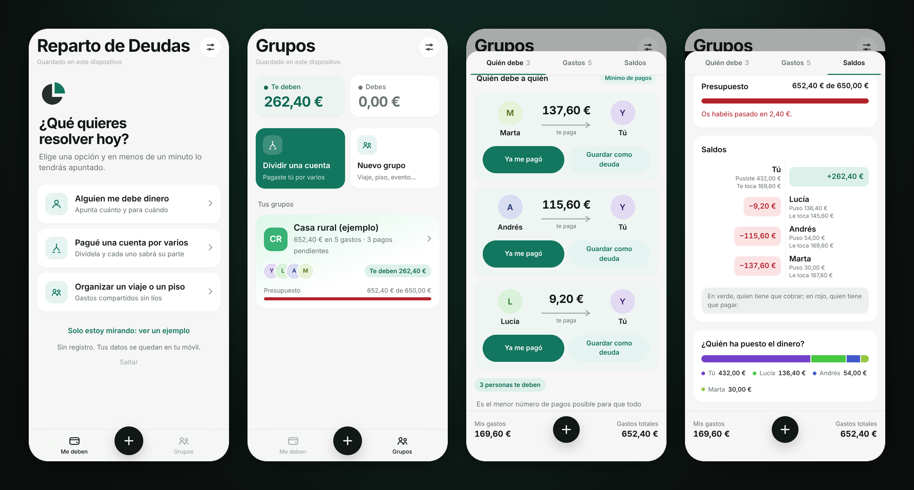
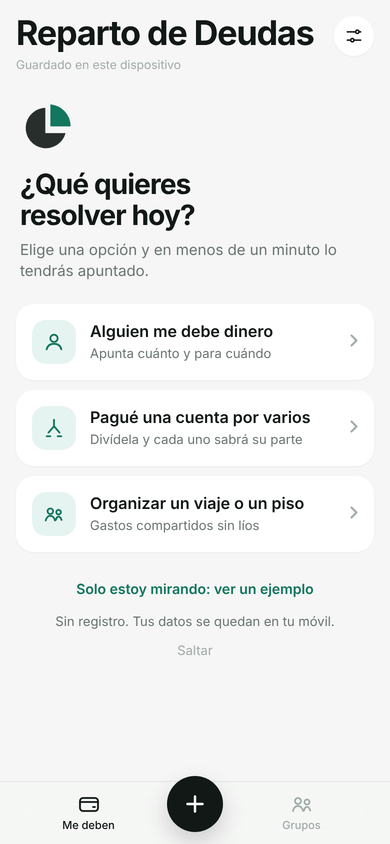
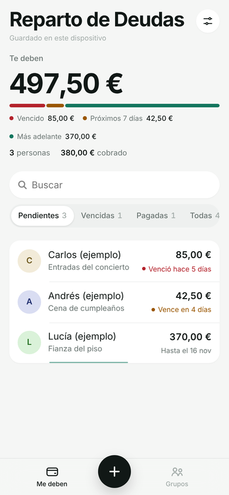
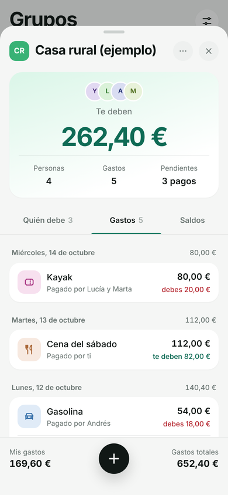

<div align="center">


# Reparto de Deudas

**Apunta quién te debe dinero y reparte los gastos del grupo sin discusiones.**
Sabes en segundos quién puso qué, qué le toca a cada uno y quién paga a quién.

[](https://github.com/N23GR045/Reparto-de-deudas-/releases/latest)
[](https://github.com/N23GR045/Reparto-de-deudas-/actions/workflows/apk.yml)


[](LICENSE)

[**⬇️ Descargar para Android**](https://github.com/N23GR045/Reparto-de-deudas-/releases/latest/download/reparto-de-deudas.apk) · [**🌐 Abrir la versión web**](https://n23gr045.github.io/Reparto-de-deudas-/) · [Ver todas las versiones](https://github.com/N23GR045/Reparto-de-deudas-/releases)

<!-- Vídeo de presentación: arrastra el .mp4 a esta línea desde el editor de GitHub y se insertará aquí. -->



</div>

---

## ¿Qué es?

Prestas dinero a un amigo, pagas la cena de cuatro o compartís piso, y al final nadie se acuerda de quién debe qué. **Reparto de Deudas** lo apunta por ti y te dice exactamente cuánto te deben, cuánto debes y la forma más sencilla de dejar las cuentas a cero.

Funciona **sin cuenta y sin internet**, en **español e inglés**: tus datos se quedan en tu móvil.

## ✨ Características principales

| | Qué hace | Por qué te ayuda |
|---|---|---|
| 💸 **Me deben** | Apunta a quién prestaste, cuánto y hasta cuándo. Suma pagos parciales o préstamos nuevos. | Ves de un vistazo lo vencido, lo que vence esta semana y lo que ya has cobrado. |
| 🧾 **Dividir una cuenta** | Pagaste por varios: escribes el total, marcas a quién y listo. | Cada parte se convierte en una deuda en un solo toque. |
| 👥 **Grupos** | Viajes, piso, cenas o proyectos con pestañas **Quién debe**, **Gastos** y **Saldos**. | Todo el mundo ve lo mismo: quién puso el dinero y qué le toca. |
| ⚖️ **Repartos flexibles** | A partes iguales, por partes o por importes; varios pagadores y otras monedas. | Se adapta a cualquier situación real, no solo a la cuenta a medias. |
| 🔁 **Mínimo de pagos** | Calcula la forma de saldar el grupo con el menor número de transferencias. | Menos Bizums, menos líos. Se puede desactivar. |
| 📊 **Presupuesto y estadísticas** | Presupuesto con avisos al 80 % y al 100 %, y gasto por categorías. | Sabes en qué se va el dinero antes de pasarte. |
| 💬 **Recordatorios y resumen** | Mensaje listo para WhatsApp y exportación a CSV. | Recordar una deuda deja de ser incómodo. |
| 🎨 **A tu gusto** | Tema claro u oscuro, 10 colores, tamaño del texto, 12 monedas y español o inglés. | La app se adapta a ti, no al revés. |
| ↩️ **Sin miedo a equivocarte** | Cada pago se puede deshacer al momento, y la app te recuerda hacer copia de tus datos. | Usarla da confianza desde el primer día. |
| 🔄 **Se actualiza sola** | Avisa cuando hay una versión nueva y se instala encima. | Siempre tienes lo último sin perder tus datos. |

## 🚀 Instalación rápida

### Android

1. Abre este enlace en el móvil: **[reparto-de-deudas.apk](https://github.com/N23GR045/Reparto-de-deudas-/releases/latest/download/reparto-de-deudas.apk)**
2. Abre el archivo descargado y pulsa **Instalar**. Si Android lo pide, permite instalar apps de este origen.
3. Listo. Cuando haya una versión nueva, la propia app te avisará.

### iPhone

1. Abre **[la versión web](https://n23gr045.github.io/Reparto-de-deudas-/)** en **Safari**.
2. Pulsa **Compartir** → **Añadir a pantalla de inicio**.
3. Se abrirá a pantalla completa, con su icono, y también funcionará sin conexión.

### Ordenador

Abre la [versión web](https://n23gr045.github.io/Reparto-de-deudas-/) en cualquier navegador, o descarga el repositorio y abre `index.html` con un doble clic.

## 📖 Guía de uso

La primera vez que la abres, la app te pregunta **qué quieres resolver hoy** y te lleva directo a ello. Después, el botón **+** de abajo siempre te ofrece las mismas opciones, estés donde estés.

<table>
<tr>
<td width="50%" valign="top">

**Alguien te debe dinero**

1. Pulsa **+** → **Le presté dinero**.
2. Escribe cuánto, a quién y, si quieres, hasta cuándo.
3. Cuando te pague, abre la deuda y pulsa **Me ha pagado** o **Lo pagó todo**.

¿Le prestas más? Abre su deuda → **Le presto más**.

</td>
<td width="50%" valign="top">

**Pagaste la cuenta por varios**

1. Pulsa **+** → **Dividir una cuenta**.
2. Escribe el total y marca a quién se reparte.
3. Pulsa **Apuntar en Me deben**: cada uno queda con su parte pendiente.

</td>
</tr>
<tr>
<td valign="top">

**Un viaje o un piso compartido**

1. **Grupos** → **Nuevo grupo** y añade a las personas.
2. Apunta cada gasto con **+**: qué fue, cuánto, quién pagó y para quién.
3. En **Quién debe** verás los pagos que dejan el grupo a cero.

</td>
<td valign="top">

**Cerrar las cuentas**

- **Ya me pagó** o **Ya está pagado**: el grupo se recalcula. ¿Te has equivocado? Pulsa **Deshacer** en el aviso.
- **Guardar como deuda**: lleva lo que te deben a tu lista personal.
- Menú **⋯** del grupo → **Exportar**: resumen para WhatsApp o archivo CSV para Excel.

</td>
</tr>
</table>

<p align="center">
  
  &nbsp;&nbsp;
  
  &nbsp;&nbsp;
  
</p>

### 🔒 Tus datos

- Todo se guarda **en tu dispositivo**. No hay servidor ni cuenta, y no se envía nada a ningún sitio.
- Si cambias de móvil o borras los datos del navegador, se pierden. La app te recuerda cada dos semanas hacer una copia (**Personalizar → Exportar copia**), que recuperas con **Importar copia**.
- En el iPhone, Safari y la app de la pantalla de inicio guardan los datos por separado: usa siempre la misma.

## 🤝 Cómo contribuir

¡Las ideas y mejoras son bienvenidas!

1. **¿Has encontrado un fallo o tienes una idea?** Abre un [issue](https://github.com/N23GR045/Reparto-de-deudas-/issues) contando qué esperabas y qué pasó. Una captura de pantalla ayuda mucho.
2. **¿Quieres cambiar código?** Haz un *fork*, crea una rama (`git checkout -b mejora-recordatorios`) y abre `index.html` en el navegador para probar. No hace falta instalar nada.
3. **Pruébalo en el móvil** o con el navegador a tamaño de móvil (unos 390 px de ancho), en tema claro y oscuro.
4. **Escribe el mensaje del commit pensando en quien usa la app.** La primera línea y las viñetas se convierten en las *Novedades* que ve la gente al actualizar. Por ejemplo: `Recordatorio automático cuando vence una deuda`.
5. Abre un **Pull Request** contra `main` explicando el cambio.

<details>
<summary><b>Detalles técnicos</b></summary>

| Pieza | Tecnología |
|---|---|
| App | Un solo `index.html` con HTML, CSS y JavaScript, sin dependencias |
| Datos | `localStorage` del dispositivo; copia de seguridad en `.json` |
| Idiomas | Español e inglés (capa de traducción `EN` / `EN_RULES` en `index.html`; se elige en Personalizar o según el idioma del móvil) |
| Android | [Capacitor 6](https://capacitorjs.com/), compilado por GitHub Actions |
| Web e iPhone | GitHub Pages + `manifest.webmanifest` + `sw.js` (funciona sin conexión) |
| Versiones | Cada *push* a `main` publica la versión `1.N` en Releases y en Pages |

```
index.html              La app completa
manifest.webmanifest    Nombre, colores e iconos para instalarla
sw.js                   Funcionamiento sin conexión y actualizaciones de la web
icons/  assets/         Iconos de la web y del APK, y pantallas de carga
android-config/         Firma fija del APK para que las actualizaciones se instalen encima
capacitor.config.json   Configuración de la app Android
.github/workflows/      Publicación automática del APK y de la web
docs/capturas/          Imágenes de este README
```

Para compilar el APK en tu ordenador: `npm install`, `npm run web`, `npx cap add android` y `npx cap open android` (necesitas Android Studio).

Para publicar la web la primera vez: **Settings → Pages → Source: GitHub Actions**.

</details>

## 📄 Licencia

Distribuido bajo la licencia **MIT**. Puedes usarlo, modificarlo y compartirlo libremente. Consulta [LICENSE](LICENSE).

<div align="center">
<sub>Hecho para que el dinero no estropee ninguna amistad.</sub>
</div>
